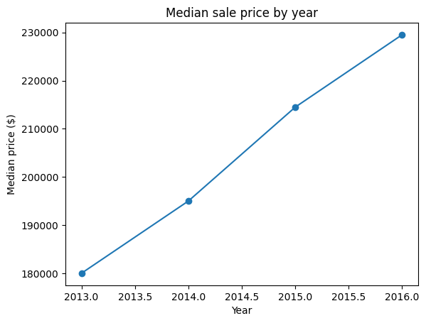
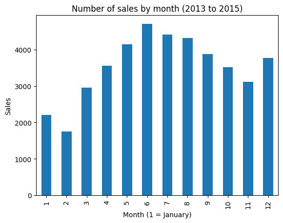
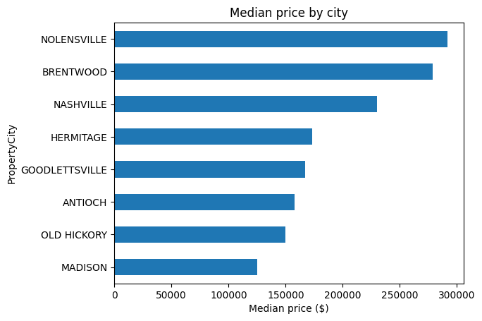
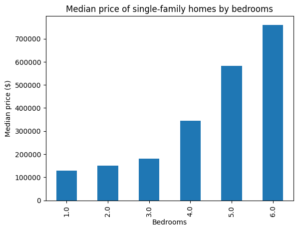
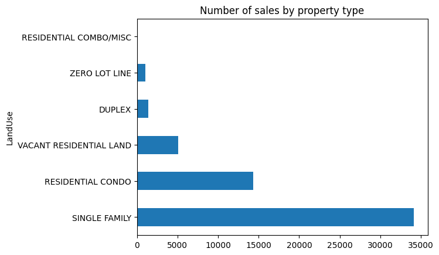

# Nashville Housing Data Analysis | Excel & Python

An end-to-end data project on the Nashville Housing Sales dataset. **Part 1** cleans the raw data using Microsoft Excel. **Part 2** explores the cleaned data in a Jupyter Notebook using pandas and matplotlib to calculate statistics, find trends and patterns, and flag anomalies.

## Dataset Overview

The dataset contains housing sales records from Nashville, Tennessee, covering the period from January 2013 to October 2016 (plus 2 stray records dated 2019 that look like entry errors).

- **Original Records:** 56,477 rows
- **Cleaned Records:** 56,374 rows
- **Original Columns:** 19
- **Cleaned Columns:** 21

## Tools & Techniques

**Part 1: Data Cleaning**
- Microsoft Excel
- Find & Replace
- TRIM
- IF and XLOOKUP
- Text to Columns
- Remove Duplicates
- Filters and PivotTables

**Part 2: Exploratory Data Analysis**
- Python 3 (pandas, matplotlib)
- Jupyter Notebook

---

# Part 1: Data Cleaning (Excel)

The project focuses on identifying and fixing data quality issues such as inconsistent values, missing addresses, duplicate records, extra spaces, and incorrect data formats.

## Data Cleaning Process

### 1. Data Standardization
- Standardized `SoldAsVacant` values by replacing Y/N with Yes/No.
- Corrected inconsistent labels in the `LandUse` column.
- Removed unnecessary spaces from address and name fields using TRIM.

### 2. Handling Missing Values
- Identified 29 missing values in `PropertyAddress`.
- Used XLOOKUP with ParcelID to retrieve missing property addresses from matching records.
- Replaced blank values in name-related columns with `UNKNOWN`.
- Kept missing numerical values blank to avoid introducing misleading data.

### 3. Splitting Address Columns
Used Text to Columns to separate combined address fields:

- `PropertyAddress` → `PropertyStreet`, `PropertyCity`
- `OwnerAddress` → `OwnerStreet`, `OwnerCity`, `OwnerState`

### 4. Duplicate Removal
- Identified duplicate sales records using ParcelID, PropertyAddress, SalePrice, SaleDate, and LegalReference.
- Excluded UniqueID from duplicate identification.
- Removed 103 duplicate records.

### 5. Data Type Correction
- Converted date fields into proper date formats.
- Corrected numerical data types for prices and property values.
- Maintained IDs and reference fields as text.

## Before & After

| Metric | Before | After |
|---|---:|---:|
| Total Rows | 56,477 | 56,374 |
| Total Columns | 19 | 21 |
| SoldAsVacant Values | 4 | 2 |
| Missing Property Addresses | 29 | 0 |
| Duplicate Records | 103 | 0 |
| Address Columns | 2 | 5 |

---

# Part 2: Exploratory Data Analysis (Python)

**Notebook:** `notebooks/Nashville_Housing_EDA_Simple.ipynb`

A beginner-friendly notebook that answers three questions: what is the typical price, what affects it, and what looks odd in the data?

## What the Notebook Does

| Step | What happens |
|---|---|
| 1. Load and prepare | Reads the Excel file, fixes small issues, adds `Year` and `Month` columns |
| 2. Key statistics | Mean, median, min, max and spread of `SalePrice` |
| 3. Five insights | Each has a calculation, a printed table, a chart and a one-line takeaway |
| 4. Anomalies | Repeated bulk-sale prices, near-zero prices, missing data |
| 5. Summary | The five findings and what to watch out for |

## Preparation Steps in the Notebook

The cleaned file had a few leftovers, so the notebook fixes them before analysing:

- Removes a stray space from a column name (`UniqueID `).
- Changes `RESIDENTIAL RESIDENTIAL CONDO` to `RESIDENTIAL CONDO` (a repeated word from a Find & Replace).
- Treats `TotalValue = 0` as missing, since zero meant "not available".
- Leaves out the 2 rows dated 2019 from the time charts.

## Key Statistics

| Metric | Value |
|---|---:|
| Sales records | 56,374 |
| Median sale price | $205,696 |
| Mean sale price | $327,518 |
| Single-family share of sales | about 61% |

The mean is about 59% higher than the median because a few very expensive sales pull the average up. **Medians are used for all price comparisons.**

## Five Key Insights

### 1. Prices rose about 28% from 2013 to 2016
The annual median sale price went from $180,000 (2013) to $229,535 (2016), and sales volume grew until 2015. 2016 only runs to October.



### 2. Most sales happen in June
June has about 2.7 times as many sales as February (4,705 vs 1,745, using 2013 to 2015). Spring and summer are the busy season.



### 3. Location affects price
Nolensville ($291k), Brentwood ($279k) and Mount Juliet ($273k) have higher median prices than Nashville ($230k). Madison ($125k) is the cheapest of the large areas.



### 4. More bedrooms means a higher price, but age barely matters
For single-family homes, the median is about $180k at 3 bedrooms, $345k at 4 and $583k at 5. Sale price correlates strongly with assessed value (r = 0.84) but barely with year built (r = 0.08).



### 5. Property type matters
Single-family homes are about 61% of sales. Condos sell for about the same as houses ($222k vs $209k), while duplexes, vacant land and zero-lot-line homes cost less.



## Anomalies Found

- **Repeated bulk-sale prices.** $13,156,000 appears on 92 condo units at 92 different addresses. It is one deal attached to every unit, not 92 separate sales, and it inflates the mean.
- **Very low prices.** 15 sales are $1,000 or less (lowest $50), likely non-market transfers.
- **Missing appraisal data.** About 54% of rows have no acreage, land value, building value or owner address, including every condo.
- **Acreage outliers.** The median is 0.27 acres but the maximum is 160, and 48 sales are over 10 acres.
- **Two sales dated 2019** in a dataset that otherwise ends in October 2016.


---

## Files Included

| File | Description |
|---|---|
| `data/NashvilleHousingUncleaned.xlsx` | Original dataset |
| `data/NashvilleHousingCleaned.xlsx` | Cleaned dataset |
| `notebooks/Nashville_Housing_EDA_Simple.ipynb` | EDA notebook |
| `images/` | The five charts from the notebook, used in this README |

## How to Run the Notebook

1. Install the requirements (Python 3.9 or newer):
   ```bash
   pip install pandas matplotlib openpyxl jupyter
   ```
2. Check the file path in the notebook's first code cell. If you keep the folder structure above, use:
   ```python
   df = pd.read_excel('../data/NashvilleHousingCleaned.xlsx')
   ```
3. Start Jupyter with `jupyter notebook`, open the notebook, and choose **Kernel → Restart & Run All**.

## Important Notes

- Missing numerical values were kept blank instead of replacing them with zero or average values.
- `TotalValue` contains zero values that represent unavailable data rather than actual zero property values.
- `TaxDistrict` was removed during cleaning.
- Extreme sale prices were retained and investigated in Part 2.
- Analyses using acreage, land value or building value leave out condos, because those fields are blank for them.
- Remove or flag bulk-sale prices and sales of $1,000 or less before building any price model.
- This is exploratory analysis. It shows patterns, not proof of cause.

## Key Learnings

Through this project, I worked on:

- Identifying and handling data quality issues.
- Standardizing inconsistent text values.
- Using lookup formulas to recover missing information.
- Splitting and transforming text columns.
- Identifying and removing duplicate records.
- Correcting data types and validating the cleaned dataset.
- Calculating summary statistics and using medians for skewed data.
- Finding trends, patterns and anomalies with pandas and matplotlib.
- Explaining findings in plain language.

This project helped me gain practical experience with Excel data cleaning and Python exploratory analysis, and understand the importance of preparing reliable data before drawing conclusions.

## Author

**Aman Alam**
