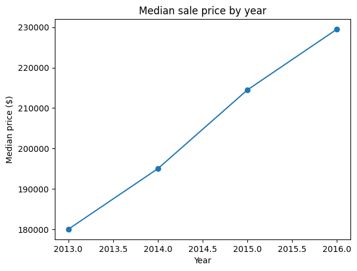
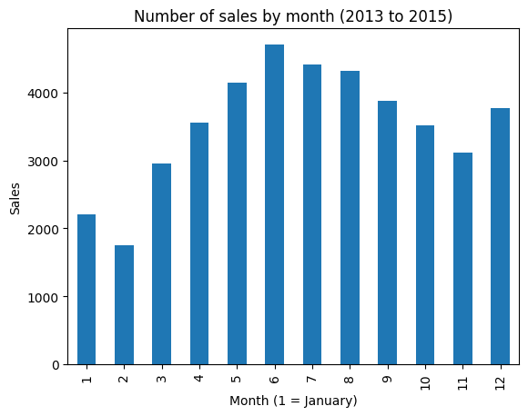
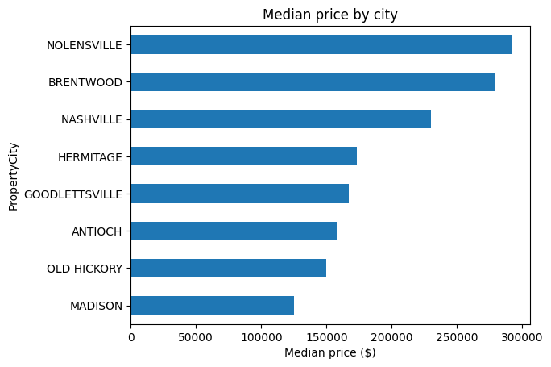
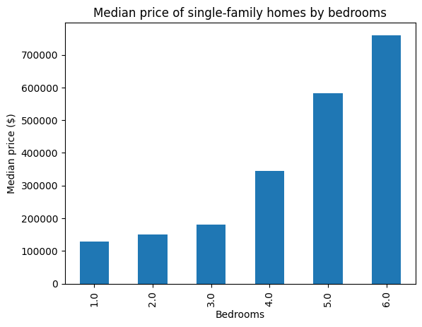
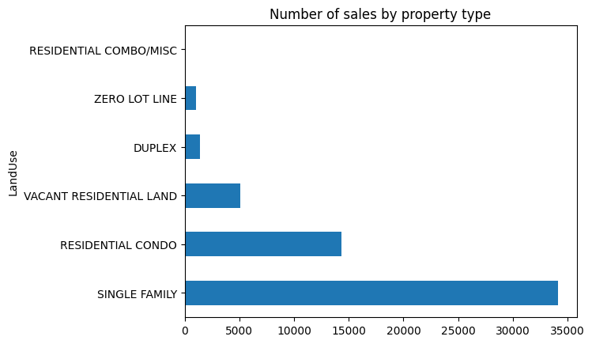
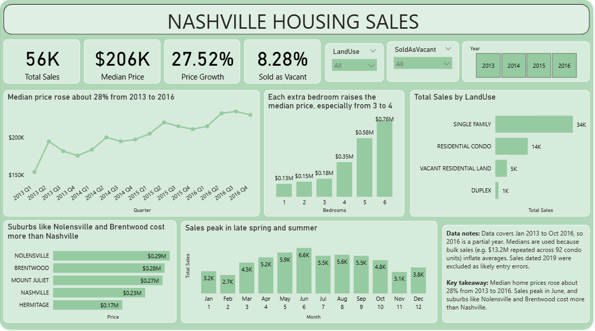

# Nashville Housing Data Analysis | Excel, Python & Power BI

📄 **[Nashville Housing Case Study (PDF)](report/Nashville_Housing_Case_Study.pdf)**

An end-to-end data project on the Nashville Housing Sales dataset.

- **Part 1:** Clean the raw data using Microsoft Excel.
- **Part 2:** Explore the cleaned data in a Jupyter Notebook (pandas and matplotlib) to calculate statistics, find trends and flag anomalies.
- **Part 3:** Build an interactive Power BI dashboard that communicates the main findings.

## Dataset Overview

The dataset contains housing sales records from Nashville, Tennessee, covering the period from January 2013 to October 2016 (plus 2 stray records dated 2019 that look like entry errors).

- **Original Records:** 56,477 rows
- **Cleaned Records:** 56,374 rows
- **Original Columns:** 19
- **Cleaned Columns:** 21

## Tools & Techniques

**Part 1: Data Cleaning**
- Microsoft Excel
- Find & Replace
- TRIM
- IF and XLOOKUP
- Text to Columns
- Remove Duplicates
- Filters and PivotTables

**Part 2: Exploratory Data Analysis**
- Python 3 (pandas, matplotlib)
- Jupyter Notebook

**Part 3: Dashboard**
- Power BI Desktop
- Power Query (data preparation)
- DAX measures
- Slicers and cross-filtering

---

# Part 1: Data Cleaning (Excel)

The project focuses on identifying and fixing data quality issues such as inconsistent values, missing addresses, duplicate records, extra spaces, and incorrect data formats.

## Data Cleaning Process

### 1. Data Standardization
- Standardized `SoldAsVacant` values by replacing Y/N with Yes/No.
- Corrected inconsistent labels in the `LandUse` column.
- Removed unnecessary spaces from address and name fields using TRIM.

### 2. Handling Missing Values
- Identified 29 missing values in `PropertyAddress`.
- Used XLOOKUP with ParcelID to retrieve missing property addresses from matching records.
- Replaced blank values in name-related columns with `UNKNOWN`.
- Kept missing numerical values blank to avoid introducing misleading data.

### 3. Splitting Address Columns
Used Text to Columns to separate combined address fields:

- `PropertyAddress` → `PropertyStreet`, `PropertyCity`
- `OwnerAddress` → `OwnerStreet`, `OwnerCity`, `OwnerState`

### 4. Duplicate Removal
- Identified duplicate sales records using ParcelID, PropertyAddress, SalePrice, SaleDate, and LegalReference.
- Excluded UniqueID from duplicate identification.
- Removed 103 duplicate records.

### 5. Data Type Correction
- Converted date fields into proper date formats.
- Corrected numerical data types for prices and property values.
- Maintained IDs and reference fields as text.

## Before & After

| Metric | Before | After |
|---|---:|---:|
| Total Rows | 56,477 | 56,374 |
| Total Columns | 19 | 21 |
| SoldAsVacant Values | 4 | 2 |
| Missing Property Addresses | 29 | 0 |
| Duplicate Records | 103 | 0 |
| Address Columns | 2 | 5 |

---

# Part 2: Exploratory Data Analysis (Python)

**Notebook:** `notebooks/Nashville_Housing_EDA_Simple.ipynb`

A beginner-friendly notebook that answers three questions: what is the typical price, what affects it, and what looks odd in the data?

## What the Notebook Does

| Step | What happens |
|---|---|
| 1. Load and prepare | Reads the Excel file, fixes small issues, adds `Year` and `Month` columns |
| 2. Key statistics | Mean, median, min, max and spread of `SalePrice` |
| 3. Five insights | Each has a calculation, a printed table, a chart and a one-line takeaway |
| 4. Anomalies | Repeated bulk-sale prices, near-zero prices, missing data |
| 5. Summary | The five findings and what to watch out for |

## Preparation Steps in the Notebook

The cleaned file had a few leftovers, so the notebook fixes them before analysing:

- Removes a stray space from a column name (`UniqueID `).
- Changes `RESIDENTIAL RESIDENTIAL CONDO` to `RESIDENTIAL CONDO` (a repeated word from a Find & Replace).
- Treats `TotalValue = 0` as missing, since zero meant "not available".
- Leaves out the 2 rows dated 2019 from the time charts.

## Key Statistics

| Metric | Value |
|---|---:|
| Sales records | 56,374 |
| Median sale price | $205,696 |
| Mean sale price | $327,518 |
| Single-family share of sales | about 61% |

The mean is about 59% higher than the median because a few very expensive sales pull the average up. **Medians are used for all price comparisons.**

## Five Key Insights

### 1. Prices rose about 28% from 2013 to 2016
The annual median sale price went from $180,000 (2013) to $229,535 (2016), and sales volume grew until 2015. 2016 only runs to October.



### 2. Most sales happen in June
June has about 2.7 times as many sales as February (4,705 vs 1,745, using 2013 to 2015). Spring and summer are the busy season.



### 3. Location affects price
Nolensville ($291k), Brentwood ($279k) and Mount Juliet ($273k) have higher median prices than Nashville ($230k). Madison ($125k) is the cheapest of the large areas.



### 4. More bedrooms means a higher price, but age barely matters
For single-family homes, the median is about $180k at 3 bedrooms, $345k at 4 and $583k at 5. Sale price correlates strongly with assessed value (r = 0.84) but barely with year built (r = 0.08).



### 5. Property type matters
Single-family homes are about 61% of sales. Condos sell for about the same as houses ($222k vs $209k), while duplexes, vacant land and zero-lot-line homes cost less.



## Anomalies Found

- **Repeated bulk-sale prices.** $13,156,000 appears on 92 condo units at 92 different addresses. It is one deal attached to every unit, not 92 separate sales, and it inflates the mean.
- **Very low prices.** 15 sales are $1,000 or less (lowest $50), likely non-market transfers.
- **Missing appraisal data.** About 54% of rows have no acreage, land value, building value or owner address, including every condo.
- **Acreage outliers.** The median is 0.27 acres but the maximum is 160, and 48 sales are over 10 acres.
- **Two sales dated 2019** in a dataset that otherwise ends in October 2016.

---

# Part 3: Power BI Dashboard

**File:** `dashboard/Nashville_Housing_Dashboard.pbix`

An interactive one-page dashboard that turns the findings from Part 2 into visuals anyone can explore.



## KPIs

| KPI | Value | How it is calculated |
|---|---:|---|
| Total Sales | 56K | Count of sales records |
| Median Price | $206K | Median of `SalePrice` |
| Price Growth | 27.52% | Change in median price from 2013 to 2016 |
| Sold as Vacant | 8.28% | Share of sales where `SoldAsVacant = Yes` |

## Charts

| Chart | Finding it shows |
|---|---|
| Median price by quarter (line) | Median price rose about 28% from 2013 to 2016 |
| Median price by bedrooms (column) | Each extra bedroom raises the median price, especially from 3 to 4 |
| Total sales by land use (bar) | Single-family homes and condos make up most sales |
| Top 5 cities by median price (bar) | Suburbs like Nolensville and Brentwood cost more than Nashville |
| Sales by month (column) | Sales peak in late spring and summer |

## Filters

- **Year:** tile slicer (2013 to 2016)
- **LandUse:** dropdown slicer
- **SoldAsVacant:** dropdown slicer

All slicers cross-filter the KPIs and charts, so you can explore a property type or year on the whole page.

## Data Preparation (Power Query)

- Renamed `UniqueID ` to remove the trailing space.
- Changed `RESIDENTIAL RESIDENTIAL CONDO` to `RESIDENTIAL CONDO`.
- Treated `TotalValue = 0` as missing (null).
- Set correct data types (dates, numbers, text IDs).
- Added `Year`, `Month`, `MonthName` and `Quarter` columns.
- Excluded the 2 records dated 2019.

## DAX Measures

```
Total Sales = COUNTROWS(Housing)
Median Price = MEDIAN(Housing[SalePrice])
Median Price 2013 = CALCULATE([Median Price], Housing[Year] = 2013, ALL(Housing[Year]))
Median Price 2016 = CALCULATE([Median Price], Housing[Year] = 2016, ALL(Housing[Year]))
Price Growth % = DIVIDE([Median Price 2016] - [Median Price 2013], [Median Price 2013])
% Sold as Vacant = DIVIDE(CALCULATE(COUNTROWS(Housing), Housing[SoldAsVacant] = "Yes"), [Total Sales])
```

## Dashboard Notes

- **Medians, not averages,** are used for prices because bulk sales (for example $13.2M repeated across 92 condo units) inflate averages.
- 2016 is a partial year (data ends in October), so the price growth compares full-year medians for 2013 with the partial year 2016.
- The monthly chart includes all years, so its counts are higher than the 2013 to 2015 figures in Part 2. The June peak appears either way.
- Opening the `.pbix` file needs **Power BI Desktop** (Windows). If you can't open it, the screenshot above shows the final result.

---

## Files Included

| File | Description |
|---|---|
| `data/NashvilleHousingUncleaned.xlsx` | Original dataset |
| `data/NashvilleHousingCleaned.xlsx` | Cleaned dataset |
| `notebooks/Nashville_Housing_EDA_Simple.ipynb` | EDA notebook |
| `dashboard/Nashville_Housing_Dashboard.pbix` | Power BI dashboard |
| `images/` | Charts and dashboard screenshot used in this README |

## How to Run the Notebook

1. Install the requirements (Python 3.9 or newer):
   ```bash
   pip install pandas matplotlib openpyxl jupyter
   ```
2. Check the file path in the notebook's first code cell. If you keep the folder structure above, use:
   ```python
   df = pd.read_excel('../data/NashvilleHousingCleaned.xlsx')
   ```
3. Start Jupyter with `jupyter notebook`, open the notebook, and choose **Kernel → Restart & Run All**.

## Important Notes

- Missing numerical values were kept blank instead of replacing them with zero or average values.
- `TotalValue` contains zero values that represent unavailable data rather than actual zero property values.
- `TaxDistrict` was removed during cleaning.
- Extreme sale prices were retained and investigated in Part 2.
- Analyses using acreage, land value or building value leave out condos, because those fields are blank for them.
- Remove or flag bulk-sale prices and sales of $1,000 or less before building any price model.
- This is exploratory analysis. It shows patterns, not proof of cause.

## Key Learnings

Through this project, I worked on:

- Identifying and handling data quality issues.
- Standardizing inconsistent text values.
- Using lookup formulas to recover missing information.
- Splitting and transforming text columns.
- Identifying and removing duplicate records.
- Correcting data types and validating the cleaned dataset.
- Calculating summary statistics and using medians for skewed data.
- Finding trends, patterns and anomalies with pandas and matplotlib.
- Preparing data in Power Query and writing DAX measures.
- Designing an interactive dashboard with KPIs, charts and slicers.
- Explaining findings in plain language.

This project helped me gain practical experience across the full workflow: cleaning data in Excel, exploring it in Python, and presenting the results in Power BI, and understand the importance of preparing reliable data before drawing conclusions.

## Author

**Aman Alam**
